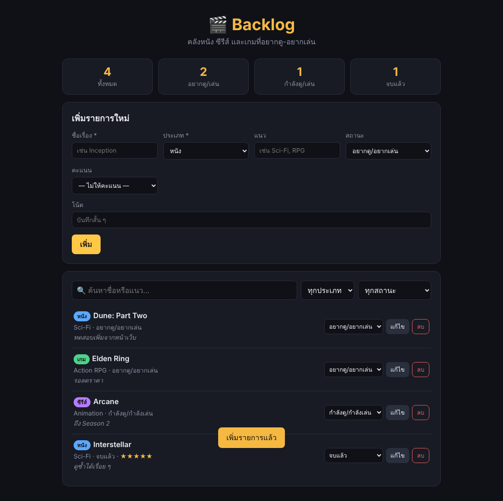
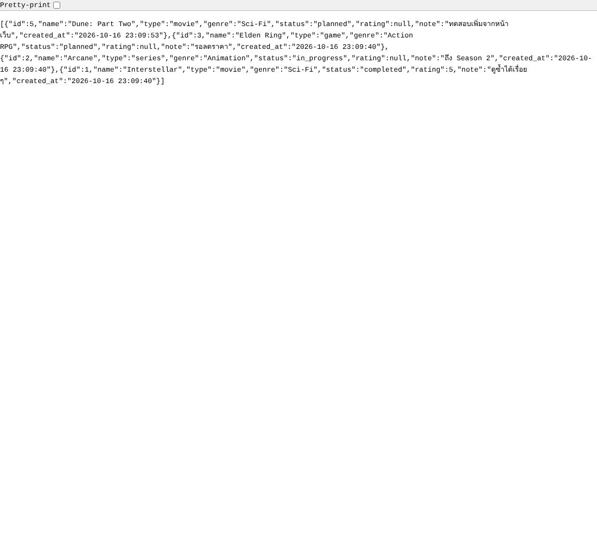

# 🎬 Backlog — คลังหนัง ซีรีส์ และเกมที่อยากดู-อยากเล่น

Mini Project #2: เว็บแอปพลิเคชันขนาดเล็กที่มีทั้งฝั่งเซิร์ฟเวอร์ (backend) และฝั่งไคลเอนต์ (frontend) โดยฝั่งเซิร์ฟเวอร์เชื่อมต่อกับฐานข้อมูล SQLite

## แอปนี้ทำอะไร

Backlog ใช้จดรายการ **หนัง ซีรีส์ และเกม** ที่อยากดูหรืออยากเล่น แล้วติดตามความคืบหน้าได้

- เพิ่ม / แก้ไข / ลบ รายการ (CRUD ครบ)
- ระบุประเภท (หนัง / ซีรีส์ / เกม), แนว, สถานะ, คะแนน 1–5 ดาว และโน้ต
- เปลี่ยนสถานะได้ทันทีจากรายการ (อยากดู/อยากเล่น → กำลังดู/กำลังเล่น → จบแล้ว)
- ค้นหาจากชื่อหรือแนว และกรองตามประเภท/สถานะ
- แสดงสถิติสรุปจำนวนรายการแต่ละสถานะ
- ข้อมูลทั้งหมดเก็บในฐานข้อมูล SQLite (`server/backlog.db`) ไม่หายเมื่อปิดเซิร์ฟเวอร์

**Resource:** `titles` (รายการหนัง/ซีรีส์/เกม)

## เทคโนโลยีที่ใช้

| ส่วน | เทคโนโลยี |
| --- | --- |
| Backend | Node.js, Express |
| Database | SQLite (ผ่านไลบรารี `better-sqlite3`) |
| Frontend | HTML, CSS, JavaScript (Fetch API) |
| Dev tool | nodemon |

## โครงสร้างโปรเจกต์

```
backlog/
├── server/                 # ฝั่งเซิร์ฟเวอร์ (backend)
│   ├── index.js            # จุดเริ่มต้น Express server
│   ├── db.js               # เชื่อมต่อ SQLite + สร้างตาราง + ข้อมูลตัวอย่าง
│   └── routes/
│       └── titles.js       # REST API ของ resource "titles"
├── public/                 # ฝั่งไคลเอนต์ (frontend)
│   ├── index.html
│   ├── style.css
│   └── app.js              # เรียก API ด้วย fetch และแสดงผล
├── docs/                   # ภาพหลักฐานสำหรับ README
├── package.json
└── README.md
```

## โครงสร้างฐานข้อมูล

ตาราง `titles`

| คอลัมน์ | ชนิด | รายละเอียด |
| --- | --- | --- |
| `id` | INTEGER | Primary key, เพิ่มอัตโนมัติ |
| `name` | TEXT | ชื่อเรื่อง (จำเป็น) |
| `type` | TEXT | `movie`, `series`, `game` (จำเป็น) |
| `genre` | TEXT | แนว |
| `status` | TEXT | `planned` (ค่าเริ่มต้น), `in_progress`, `completed` |
| `rating` | INTEGER | คะแนน 1–5 |
| `note` | TEXT | โน้ต |
| `created_at` | TEXT | วันเวลาที่สร้าง |

ตารางจะถูกสร้างอัตโนมัติเมื่อรันครั้งแรก พร้อมข้อมูลตัวอย่าง 3 รายการ

## วิธีติดตั้ง

ต้องมี [Node.js](https://nodejs.org/) เวอร์ชัน 18 ขึ้นไป

```bash
git clone <ลิงก์ repository นี้>
cd backlog
npm install
```

## วิธีรัน

```bash
npm run dev
```

จากนั้นเปิดเบราว์เซอร์ไปที่ **http://localhost:3000**

(หรือใช้ `npm start` เพื่อรันแบบปกติโดยไม่ใช้ nodemon)

## รายการ Endpoint ทั้งหมด

Base URL: `http://localhost:3000/api/titles`

| Method | Endpoint | คำอธิบาย |
| --- | --- | --- |
| GET | `/api/titles` | ดึงรายการทั้งหมด (กรองได้ด้วย query `?type=`, `?status=`, `?q=`) |
| GET | `/api/titles/stats` | สรุปจำนวนรายการตามสถานะและประเภท |
| GET | `/api/titles/:id` | ดึงรายการตาม id |
| POST | `/api/titles` | เพิ่มรายการใหม่ |
| PUT | `/api/titles/:id` | แก้ไขรายการ (ส่งเฉพาะฟิลด์ที่ต้องการเปลี่ยนได้) |
| DELETE | `/api/titles/:id` | ลบรายการ |

### ตัวอย่างการใช้งาน

**เพิ่มรายการ** — `POST /api/titles`

```json
{
  "name": "Dune: Part Two",
  "type": "movie",
  "genre": "Sci-Fi",
  "status": "planned",
  "note": "ดูในโรง IMAX"
}
```

Response `201 Created`

```json
{
  "id": 4,
  "name": "Dune: Part Two",
  "type": "movie",
  "genre": "Sci-Fi",
  "status": "planned",
  "rating": null,
  "note": "ดูในโรง IMAX",
  "created_at": "2026-10-16 23:09:42"
}
```

**แก้ไขสถานะและให้คะแนน** — `PUT /api/titles/4`

```json
{ "status": "completed", "rating": 4 }
```

**กรองเฉพาะหนัง** — `GET /api/titles?type=movie`

**สถิติ** — `GET /api/titles/stats`

```json
{ "total": 3, "planned": 1, "in_progress": 1, "completed": 1, "movie": 1, "series": 1, "game": 1 }
```

### การจัดการข้อผิดพลาด

| สถานะ | กรณี | ตัวอย่าง response |
| --- | --- | --- |
| 400 | ข้อมูลไม่ครบหรือไม่ถูกต้อง | `{ "error": "name is required" }` |
| 404 | ไม่พบรายการตาม id | `{ "error": "Title not found" }` |
| 404 | เรียก endpoint ที่ไม่มีอยู่ | `{ "error": "Endpoint not found" }` |

## ภาพหลักฐานการดีบัก

### 1. ฝั่งไคลเอนต์ (Frontend)

หน้าเว็บแสดงสถิติ ฟอร์มเพิ่มรายการ และรายการทั้งหมด หลังเพิ่ม "Dune: Part Two" ผ่านฟอร์มสำเร็จ (มีข้อความแจ้ง "เพิ่มรายการแล้ว")



### 2. ฝั่งเซิร์ฟเวอร์ (Backend)

ผลลัพธ์จาก `GET /api/titles` ที่เซิร์ฟเวอร์ดึงข้อมูลจากฐานข้อมูล SQLite แล้วส่งกลับเป็น JSON


